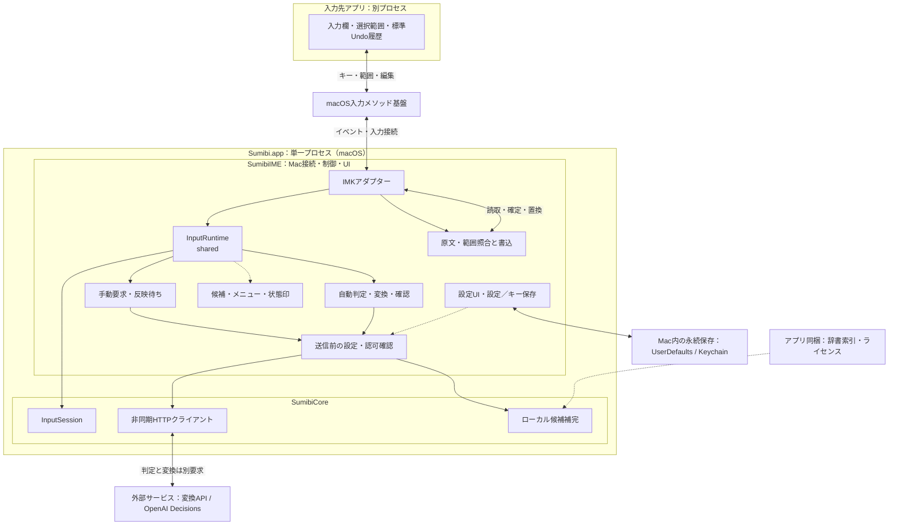
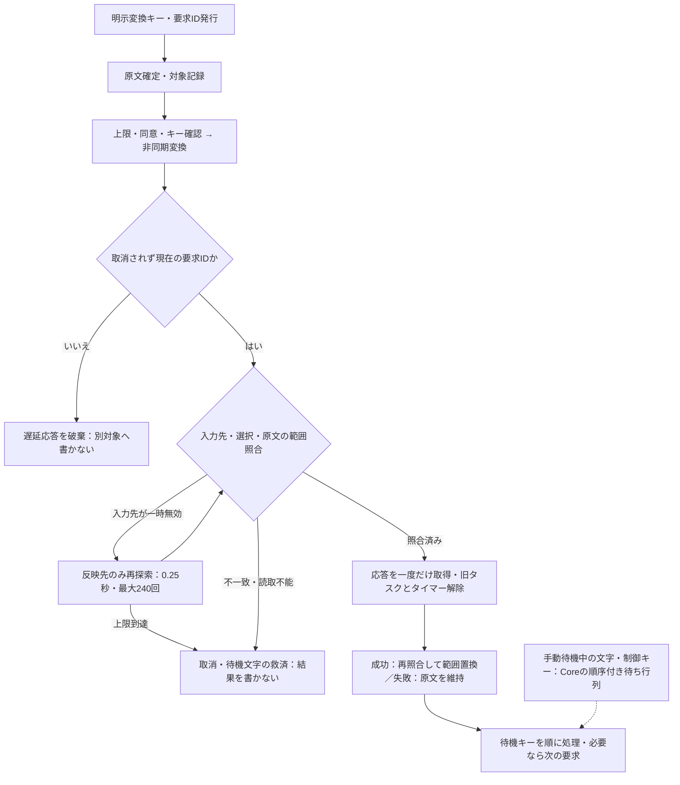
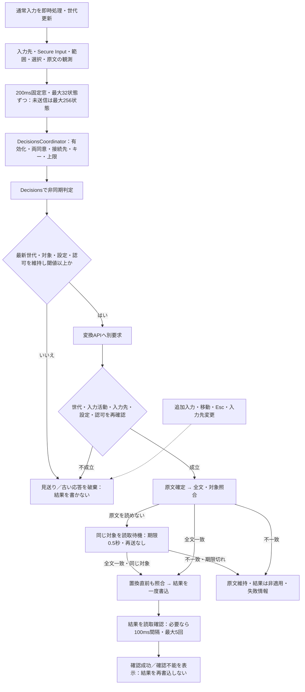

# Sumibi for macOS 技術解説

## 1. 文書の範囲と状態

2026-10-20、Issue #64で図とコードを照合した実装の説明。
基準mainは`d2b96fc2d2e7bf08a597e2ba46132712b6785d93`（PR #65まで）。
記号サポートはPR #61でmainへ統合済み。原文比較・診断画面の独立化は
[PR #66](https://github.com/kiyoka/Sumibi-mac/pull/66)として区別する。
2026-10-31、PR #67の図を保持したままPR #66へmainを取り込み、画面の説明を追従させた。
以下の図は元の基準mainを表し、PR #66による変更点は注記で示す。
今回は文書の更新であり、機能・保存形式・製品仕様を変更しない。

[SPEC](SPEC.md)は合意した要件であり、全機能の実装完了を意味しない。本書では「実装済み」「未実装の要件」「観測・実機確認」「将来案」を分ける。仕様とコードの差、参照したコード・テストは[実装照合記録](IMPLEMENTATION_AUDIT.md)に記載する。以前の設計案と詳しいアプリ別の調査は[旧技術解説](TECHNICAL_OVERVIEW_HISTORY.md)・[Issue #4の調査記録](ISSUE_4_PROTOTYPE.md)へ保存した。

最小対応OSはmacOS 26という要件を維持する。以下のセッション再生成などの観測は開発環境のmacOS 27であり、全対応OS・全アプリでの確認とは扱わない。macOS版はiOS版を参考に独立実装し、共有パッケージを利用しない。自己配布版はBYOKを利用し、PCC経路は実装しない。

## 2. 単一バンドル・単一プロセスの構成（実装済み）

```text
Sumibi.app / 実行ファイル Sumibi
├─ SumibiMain: IMKServer生成、AppKitイベントループ
├─ SumibiInputController: IMKイベントの受付・接続
│  └─ InputRuntime.shared: 有効な入力経路の状態
│     ├─ InputSession: 追跡文字列・要求ID・待機キー・候補
│     ├─ TextReplacementTracker: 範囲と原文の照合
│     ├─ ConversionLifecycle: 通信・応答・反映待ちタイマー
│     ├─ AmbientConversionLifecycle: Decisions集約・判定・変換・読取確認
│     ├─ ConversionResultVerifier: 手動置換後の読取確認
│     ├─ ConversionFeedback / CaretDecisionCue: 固定エラー・短時間の状態印
│     └─ CandidatePresenter → CandidateWindow: 独自候補窓
├─ MenuBarController: NSStatusItem・ログイン項目
└─ SettingsWindowController → APISettingsView: SwiftUI設定・辞書・Decisions
   └─ 一時デバッグ: mainではDecisionsSettingsView内
```

通常起動は[SumibiMain](../Sources/SumibiIME/SumibiMain.swift)がInfo.plistのBundle IDと接続名からIMKServerを作り、その寿命をイベントループ中保持する。同じプロセスでメニューバーを設置し、設定ウィンドウを必要時に開く。別の設定アプリ・常駐ヘルパー・App Groupは現行構成にない。別アプリへの分離は将来再設計する場合の案であり、配布の成立条件ではない。

Packageは`Sumibi`、モジュールは`SumibiCore`と`SumibiIME`。バンドル素材は`App/`、開発ツールは`Development/`。登録ID・設定・Keychainの互換性と通常／開発ビルドは[ビルドモード](BUILD_MODES.md)を参照。

<a id="runtime-architecture"></a>
### 2.1 全体アーキテクチャ図

以下は**基準mainの実行時**。枠はプロセス／モジュールの境界、実線矢印はイベント・呼出し・
読取／書込・要求／応答、破線矢印は表示用情報・設定や資産の参照を表す。
双方向線は両方向のやり取りであり、共有メモリや所有を意味しない。
主経路だけを描き、同意・保存・通信の詳細は[データ境界](#data-boundaries)、
所有関係は[寿命の補助図](INPUT_CONTROLLER_ARCHITECTURE.md#ownership-diagram)へ分ける。



`SumibiMain`がIMKServerとAppKitイベントループを維持する。図のCoreは別プロセスではなく
同じ実行ファイルのモジュールであり、通信クライアントも含む。状態機械・辞書検索は移植時に
参照しやすいが、**SumibiCore全体のWindows互換を検証済みとは扱わない**。
現行PackageはmacOS対象で、Foundationの通信・文字列処理も移植先で検証する。
設定UIも同一プロセスで、KeychainはOSの保存サービス。別設定アプリや独立ヘルパーは描いていない。
図の短い責務名に対応する型は、直前の構成ツリーと次の表、
[所有者の責務表](INPUT_CONTROLLER_ARCHITECTURE.md)を参照する。

「原文・範囲照合と書込」は次の協調処理をまとめたもの。

| 責務 | 実装と境界 |
| --- | --- |
| 観測時の範囲・原文照合 | [AmbientInputSnapshot](../Sources/SumibiIME/Conversion/AmbientInputSnapshot.swift)。正確な未確定範囲を読み、周辺全文探索をしない |
| 原文・対象・アンカーの照合 | [TextReplacementTracker](../Sources/SumibiIME/TextReplacementTracker.swift)。読取だけで、書込はしない |
| 手動の効果・入力先への書込 | [InputEffectApplier](../Sources/SumibiIME/InputEffectApplier.swift) → [InputClient / IMKInputClient](../Sources/SumibiIME/InputClient.swift) |
| 自動の確定・照合・置換 | [AmbientResultApplier](../Sources/SumibiIME/Conversion/AmbientResultApplier.swift)。同じInputSession・書込アダプターを使い、未照合なら結果を書かない |
| 置換後の読取確認 | 手動の[ConversionResultVerifier](../Sources/SumibiIME/Conversion/ConversionResultVerifier.swift)、自動の[AmbientResultVerification](../Sources/SumibiIME/Conversion/AmbientResultApplier.swift)。再書込ではない |

**PR／将来案の区分：** PR #66は一時デバッグを独立した`DiagnosticsSettingsView`へ移し、
観測時の原文比較を追加する。上図のmainではDecisions設定内のメモリ表示であり、独立画面が
統合済みとは読まない。周辺文脈・文体・一般利用額集計・Windowsの方式はこの図に含めない。

<a id="data-boundaries"></a>
### 2.2 メモリ・保存・送信の境界

| 情報 | プロセス内メモリ／表示 | 永続保存・外部への境界 |
| --- | --- | --- |
| 原文・待機入力・候補・救済文字 | InputSession、Runtime、通信／反映待ち、候補UI | 通常ログ・設定へ保存しない。変換対象は同意した変換APIへ送る。救済文字のコピーだけ利用者操作でクリップボードへ書く |
| 接続先・モデル・送信先ごとの同意・登録ユーザー辞書・変換API利用統計 | 設定UI、ConversionCoordinator | SettingsStore → UserDefaults（接続先別設定・`provider + model`別トークン統計と記録時概算費用）。原文・候補・キーは含めない。登録辞書は変換要求に添付 |
| 自動変換の同意・閾値・回数上限・累積HTTP回数 | DecisionsCoordinator、AmbientConversionLifecycle | DecisionsSettingsStore → UserDefaults。上限は請求額ではない（変換APIの利用統計とは別管理） |
| APIキー | APIKeyStoreから送信先エンドポイント別に通信設定へ読み出す。画面は短い伏せ字 | Keychainのみ（`account = "endpoint:<url>"`、端末限定・同期無効）。旧`default`キーは元の所有エンドポイントにのみ移行。HTTP認証ヘッダーで送信し、別接続先・本文・ログへ混ぜない |
| 判定対象の入力状態 | 自動変換の固定窓と未送信バッチ | DecisionsへID付き入力状態とpredicate質問を送る。変換APIとは別通信・別課金。判定にはユーザー辞書を添付しない |
| LLM要求 | 原文、追加候補時の現在結果、登録ユーザー辞書 | ConversionCoordinatorが文字数・接続先・キー・送信同意を確認後に送信。周辺文脈・文体は未実装 |
| 中黒・Mozc・Sudachi索引 | 追加候補成功時だけローカル補完 | バンドル資産を読む。索引全体をAPIへ送らず、追加通信もしない。API失敗のオフライン代替ではない |
| 一時デバッグの本文 | 明示オン時のみメモリ表示、再起動後オフ。オフ・設定変更・次の試行等で破棄 | ログ・UserDefaults・ファイルへ保存しない。mainとPR #66の表示範囲の差を区別する |
| 診断ログ | DiagnosticLogへ固定分類・数値だけを渡す | OSログへ出力。通常は失敗分類、詳細ログ有効時は数値も含む。本文・キー・URL・生応答・アプリ名は出さない |

自動送信は既定オフで、親設定の変換送信同意に加え、現在の変換接続先（公式`OpenAI`または公式`Google`、「その他」は不可）に対する独立した自動送信同意、判定用のOpenAIキー（`endpoint:https://api.openai.com`）、および変換接続先のキーが必要。変換接続先を切り替えた場合は自動変換がオフになり再同意が必要になる。`DecisionsCoordinator.prepare`は認可済みの仕事を組み立てるだけで通信しない。
送信前・結果適用前にも設定や認可が維持されているか検査する。手動と自動の適用条件を一括して
同一とは扱わない。根拠は[ConversionCoordinator](../Sources/SumibiIME/Conversion/ConversionCoordinator.swift)、
[DecisionsCoordinator](../Sources/SumibiIME/Conversion/DecisionsCoordinator.swift)、
[DiagnosticLog](../Sources/SumibiIME/DiagnosticLog.swift)。

## 3. 状態の所有者・寿命・入力先変更

`IMKInputController`の生成単位を、文書や変換対象の寿命と同一視しない。開発環境のmacOS 27では、キーを消費した直後にも終了・再生成が起きた。そのため[InputRuntime](../Sources/SumibiIME/InputRuntime.swift)がプロセス全体で一つの有効な入力経路の状態を保持し、短い再生成をまたぐ。文書ごとの独立状態や複数入力欄を並行管理する仕組みではない。

Runtimeは状態機械・範囲追跡・通信・候補表示と、最新コントローラーの弱参照、直前のハンドラー・入力先参照を持つ。これらは応答の適用先を探すための接続情報であり、参照があるだけで安全とは判定しない。所有者とスレッドは[構成資料](INPUT_CONTROLLER_ARCHITECTURE.md)を参照。

[SumibiInputController](../Sources/SumibiIME/SumibiInputController.swift)の`deactivateServer`は、消費したキーから0.3秒未満の終了通知を短い再生成として扱う。それ以外では、必要に応じて未確定原文を確定し、`cancelForTargetChange`で要求・待機キー・直前の候補対象・アンカーを解除する。対象外アプリへ移った場合も同じ取消経路を使う。この時間判定は観測に基づく実装上の対処であり、OSが完全に入力先変更を識別してくれる保証ではない。

応答の要求IDと、入力先から読んだ範囲・選択位置・原文を照合し、不一致・読取不能なら置換しない。遅延したカーソル位置や折り返しを補正する場合も、[TextReplacementTracker](../Sources/SumibiIME/TextReplacementTracker.swift)と[WrappedText](../Sources/SumibiCore/WrappedText.swift)で対象を検証する。アンカー直後に原文が重複して挿入されている場合（Web入力欄での二重確定など）は再アンカーを拒否し、置換対象を失効させて重複後半部分の誤置換を防止する。また入力先が未確定文字列（`markedRange`）を露出したままの状態では置換書き込みを拒否する。別アプリ・同じ原文を含む別入力欄・異なるOSでの全経路の安全性を、この照合だけで実機検証済みとは扱わない。

## 4. 入力・初回変換・非同期応答（実装済み）

通常文字は[InputSession](../Sources/SumibiCore/InputSession.swift)で追跡し、`setMarkedText`で表示する。細い下線の属性を指定するが、描画するのは入力先であり、指定色が使われる保証はない。通常のEnterは原文を確定して追跡を終え、その場のイベントを入力先へ渡す。応答待ち中のEnterとは実装が異なる（次節）。

変換キーはControl + J、右Commandの短いタップ、「かな」キー。ターミナル.appで未確定文字列のないControl + JがIMEへ届かなかった観測を受け、後二つを追加した。全ターミナルで同じキー配信になるとは保証しない。

初回変換は以下の順序で行う。

1. 状態機械が原文を保持して要求IDを発行する。
2. [InputEffectApplier](../Sources/SumibiIME/InputEffectApplier.swift)が原文を通常文字として確定し、置換範囲を記録する。コントローラー再作成やDOM更新で入力先がすでに未確定文字列を確定している場合（`lastMarkedStart`位置に同一文字列が存在し未確定範囲が終了している場合）は二重挿入をスキップする。また再入による二重確定を防ぐため、挿入呼び出し前に確定フラグを立てる。未確定のまま送信する方式ではない。
3. 保存済みユーザー辞書を付け、[ConversionCoordinator](../Sources/SumibiIME/Conversion/ConversionCoordinator.swift)が文字数・送信先・APIキー・送信同意を確認する。
4. [OpenAICompatibleClient](../Sources/SumibiCore/OpenAICompatibleClient.swift)がURLSessionで非同期通信する。応答保存はMainActorへ戻す。
5. 要求IDと入力先の対象を照合し、成功なら原文の範囲を結果で置換する。置換後も[AmbientResultVerification](../Sources/SumibiIME/Conversion/AmbientResultApplier.swift)と[ConversionResultVerifier](../Sources/SumibiIME/Conversion/ConversionResultVerifier.swift)により入力先の反映結果を検証する。万一入力先が置換ではなく末尾追記した場合（カーソルが原文＋結果分進んだ場合）も検証を沈黙中断せず不一致（`.mismatch`）として検出・通知する。失敗なら原文を残して待機入力の処理を再開する。

[ConversionLifecycle](../Sources/SumibiIME/Conversion/ConversionLifecycle.swift)は一つの通信タスク、応答、反映待ちタイマーを所有する。入力先が一時的に無効なら0.25秒間隔で最大240回、応答の**反映先**を探す。これはAPIの再送ではない。照合後に応答を一度だけ取り出し、待機キーが次の要求を始める前に旧タスク・タイマーを解除する。通信のタイムアウト設定は60秒で、反映待ちの上限とは別である。

現在の文字数制限はSwiftの`String.count`で原文・現在の変換結果・ユーザー辞書を合算して1,000文字。固定システムプロンプト・JSONのメタデータはこの計数に含めない。位置と置換範囲はUTF-16で扱う。周辺文脈と文体指示は未実装であり、プロンプトの周辺文脈欄は空、追加指示は「ありません」。要件上の送信量と実装の計数範囲を混同しない。

選択範囲の変換は、追跡中の原文や安全に再変換できる直前結果がないとき、選択文字列を取得して同じ変換経路を使う。まず選択範囲を同じ文字列で確定し、応答時に照合してその範囲だけを置換する。

### 4.1 Decisions自動変換（mainへ統合済み）

[AmbientConversionLifecycle](../Sources/SumibiIME/Conversion/AmbientConversionLifecycle.swift)が
未確定入力を200msの固定窓で保持し、最大32状態を名前付きpredicate質問として判定する。
モデルは`gpt-6-luna`、既定閾値0.5、判定タイムアウト10秒。既定オフで、親画面の変換同意と
独立した自動送信同意、公式`OpenAI`または公式`Google`の変換接続先、および判定用OpenAIキーと変換用キーが必要。旧Jev通信は廃止した。

自動変換中の入力は即時処理し、古い結果を世代・原文・対象で照合して破棄する。
判定・漢字変換・読取確認を直列化し、未送信256状態、累積通信10,000回という別の上限を持つ。
確定原文と置換結果の読取だけをそれぞれ最大0.5秒確認し、API再送や未照合の書込は行わない。
原文確認は単調時計の期限付きだが、結果確認は100ms×最大5回という試行数による制限で、
スケジューラー遅延を含む厳密な実時間上限ではない。この差も移植時に引き継ぐ。
カーソル移動前には原文を確定し、待機と追跡を取り消す。macOSの再生成対策・相対座標の許容条件を
別OSの保証としない。詳細な状態・費用・実機履歴は[Decisions自動変換](DECISIONS_CONVERSION.md)を参照。

<a id="conversion-flows"></a>
### 4.2 手動／自動の非同期経路図

矢印は処理順と条件分岐で、所有関係ではない。通信待ちの間に対象が変わるため、
API成功と適用成功を分ける。入力先の標準Undoに原文を残すための確定と、
変換結果による置換も別操作である。

**手動（初回・選択変換の主経路）：** 追加候補は同じ通信所有者を使うが、要求時に現在結果を
書き換えず、成功時の候補選択で照合・置換する。API成功直後の自動置換と混同しない。



ネットワークエラーも要求の結果として扱うが、旧入力先へ復旧文字を書かないよう反映前照合を行う。
置換直前にもアンカーの原文を照合し、成功後は必要に応じて結果を読取確認する。
なお、Chromium/Electron（AntiGravityなど）では選択範囲置換後にカーソルが末尾へ折り畳まれ、カーソル前100文字より前の全文読み取りが`nil`になる特性がある。選択範囲変換（Ctrl+J）では開始時に全文が検証済みであるため、100文字を超える場合はカーソル直前の末尾100文字ウィンドウの照合により安全に置換を認可する（通常の未確定入力からの変換では100文字超の未検証置換を拒否する）。
待機中の制御キーには再送しないものがある（[第5節](#5-待機入力esc救済)）。
Esc・実際の入力先変更は要求／タイマーを取り消し、必要な待機文字を救済する。

**自動（入力は待ち行列化しない）：** バッチには入力の観測状態を保持するのであり、
キーを後から再生するものではない。現在の世代以外の状態が判定されても、その結果を別の原文へ適用しない。



追加入力は観測世代を変え、移動・Esc・入力先変更は取消処理へ進む。原文確定後の読取待機中に
入力があっても、手動用の待機キーへ入れず通常入力へ戻す。
未確定原文を読めない特定のIMK報告形は観測を許容するが、**確定後の全文一致まで置換しない**。
原文待機の0.5秒は期限付き、結果確認は試行数による制限で、UI遅延を含む厳密な0.5秒ではない。
判定エラー・変換エラーは固定エラー表示へ進み、エラー解除を次の入力の必須条件にはしない。
これらは実装上の方針であり、既知の短文不一致・長文読取不能・再開不能の解消を保証する図ではない。

図と型の対応：手動の要求ID・待機キーは`InputSession`、通信・反映待ちは`ConversionLifecycle`、
反映接続は`SumibiInputController.finishRequest`。自動の直列処理・世代検査は`AmbientConversionLifecycle`、
認可は`DecisionsCoordinator`、原文確定・範囲置換は`AmbientResultApplier`と`InputEffectApplier`が担う。

## 5. 待機入力・Esc・救済

この節の待機キーは手動変換の動作であり、Decisions自動変換中は入力を待ち行列へ蓄積しない。

応答待ち中の文字・Enter・Backspace・変換キーはCoreの順序付き待ち行列へ入る。通信完了後、元の対象を照合してCoreが順に処理する。追加入力は文字列へ反映され、次の変換が始まると排出を止める。追加候補取得だけを繰り返す連打は抑制する。

ただし、Coreが「入力先へ渡す」効果を返しても、遅延したEnter・空の追跡に対するBackspace・対象のない変換キーは、IME側では`deferredControls`へ記録するだけで入力先へ再送しない。追跡中の文字を削るBackspaceなど、Core内で完結する操作は処理する。したがって「待機中のEnterが後でチャット送信される」とは説明しない。[実装照合記録](IMPLEMENTATION_AUDIT.md)に要件との差を残す。

修飾キーなしのEscは、保留応答を反映するより先に処理する。候補窓があれば窓だけを閉じる。追跡・要求があれば、原文を維持して取消し、待機文字を救済し、制御キーを再実行しない。対象がなければEscを入力先へ渡す。修飾キー付きEscはこの取消経路では扱わない。

入力先変更や取消で救済した文字はRuntimeのメモリに残る。**IMEメニュー**から「保留文字をコピー」「保留文字を破棄」を選べる。コピーだけが明示操作でクリップボードへ書く。専用メニューバーのメニューに救済項目はない。保持期限・待ち行列容量の制限は実装されておらず、プロセス終了でメモリ上の情報は失われる。

## 6. 候補表示とUndo

現行実装は[CandidateWindow](../Sources/SumibiIME/CandidateWindow.swift)の独自AppKitウィンドウであり、IMKCandidatesは使わない。標準候補APIが調査環境で期待どおり機能しなかった経緯は[Issue #4の記録](ISSUE_4_PROTOTYPE.md)に残す。標準候補窓への変更は現行要件ではない。

初回は1件を取得して即確定する。直後の変換キーは追加候補の通信を開始する。候補取得後に表示するので、「まず窓を開き、さらに押してから初めて追加通信する」という旧設計案とは異なる。窓が表示中の変換キーは次の候補へ巡回してその場で置換する。矢印・Enter・数字1〜9・クリックによる移動／選択、Escによる窓の解除も実装するが、キーがIMEへ届くかは入力先に依存する。

追加要求のプロンプトと`ConversionMode.candidateCount`は現在結果を含む最大12件。候補は重複を除き、現在結果を先頭にする。mainにはPR #61の記号補完も統合済み。元入力全体の読みから中黒・Mozc記号を補い、LLMの全ひらがな単語候補から[HomophoneDictionary](../Sources/SumibiCore/HomophoneDictionary.swift)を検索し、辞書追加枠を合計最大10件にする。[記号仕様](SYMBOL_CANDIDATES.md)を参照。出所「LLM」「辞書」は本文と分離し、辞書全体をLLMへ送信しない。仕様書の「第二候補以降10件」との差は照合記録へ残す。

Undoは入力先の標準編集履歴へ委ねる。原文の確定と範囲指定の置換によって履歴に残す方式を採用しているが、全アプリで一回のUndoが同じ範囲を戻すという保証はしない。過去のアプリ別確認と追加の手動確認項目を区別する。

## 7. 設定・メニューバー（実装済みと未実装）

[SettingsWindowController](../Sources/SumibiIME/Settings/SettingsWindowController.swift)が一つのNSWindowとNSHostingViewを保持する。画面はAPI設定（`OpenAI`／`Google`／`その他`の接続先切替、OpenAI代表モデル／自由入力、Googleの`Gemini 3.6 Flash`／`Gemini 3.5 Flash-Lite`の2モデル選択、カスタムURL／モデル入力）、送信先・料金・同意、Decisions設定への入口（Google／その他選択時は利用不可理由を表示）、ユーザー辞書への入口、`provider + model`別の利用状況（変換回数・入力／キャッシュ入力／出力／内訳不明／合計トークン・概算USD費用・リセット）、Mozcライセンス閲覧、「診断・デバッグ…」、保存・APIキー削除。一時本文表示は明示オン・メモリ内限定・再起動後オフで、ログへ流さない。文脈・文体・変換テストは未実装である。

接続先ごとの設定・モデル・辞書・利用統計は[SettingsStore](../Sources/SumibiIME/Settings/SettingsStore.swift)のUserDefaults、APIキーは[APIKeyStore](../Sources/SumibiIME/Settings/APIKeyStore.swift)のKeychain（送信先エンドポイント別アカウント`endpoint:<url>`）へ保存する。キーは固定長の伏せ字と末尾4文字で表示し、「変更」から空の編集欄を開く。保存するまで既存キーは保持する。API入力欄は変換対象外で、辞書編集シート中だけ自アプリでの変換を許可する。

[MenuBarController](../Sources/SumibiIME/MenuBar/MenuBarController.swift)のNSStatusItemは同じプロセスが動いている間、Sumibiが入力ソースでなくても表示する。SMAppService.mainAppでアプリ自身をログイン項目へ登録し、利用者の解除は`MenuBarLoginItemOptOut`で記憶する。独立ヘルパーではない。

専用メニューバーには設定・ログイン起動の項目がある。#12の作業版では変換中・エラーの印と、クリック時の固定文による原因・対処・解除を追加した。`ConversionFeedback`は入力処理と独立し、最新エラー1件をメモリ上だけに保持する。実装・確認範囲は[変換状態の表示](CONVERSION_FEEDBACK.md)を参照。未適用制御キーは従来どおりIMEメニューへ表示する。設定画面だけを開く`--settings`は明示的な開発ビルド限定で、通常版の機能ではない。

## 8. 配布・検証の状態

ビルド・配布は上記の実行時経路とは別。開発者がSwift Package＋`App/`資産からアプリを
組み立て、配布スクリプトで署名・pkg化・Apple公証・チケット添付を行う。
利用者の変換時にビルド・公証サーバーへ入力を送る経路はない。
MacのIMK・AppKit・Keychain・UserDefaults・ServiceManagement・署名／公証はWindowsで再設計する境界。
引き継ぐのは状態・非同期競合・認可・照合・保存分離の責務であり、Windows APIやプロセス構成は決めない。
[Windows側の未決事項](WINDOWS_HANDOFF.md#8-windowsで改めて決めること)を参照。

現行ビルドはSwift Packageから単一のSumibi.appを組み立てる。[App/build.sh](../App/build.sh)はインストールしない。利用者が選んだ導入範囲は**インストールしたユーザーのみ**、配置先は`~/Library/Input Methods/Sumibi.app`。全ユーザー用を並列の未決案として扱わない。

配布用スクリプトは2026-10-17にPR #59でmainへ統合済み。0.4／build 4／arm64の検証用pkgは実Developer ID署名・Apple公証・チケット添付・Gatekeeper検査に成功したが、新規導入・更新・削除のpkg実機確認は未完了。開発署名による通常版の実機入替とも、0.9.0リリースの完成とも区別する。[配布資料](DIRECT_DISTRIBUTION.md)を参照。

最新の機能テスト実行記録は2026-10-20のPR #66で通常・開発各330件（329件成功・実60秒タイムアウト1件スキップ）。基準main単体の件数でも、今回の図追加での再実行でもない。手動・Decisions・記号の利用者確認は[照合記録](IMPLEMENTATION_AUDIT.md)と[Tests/README](../Tests/README.md)を参照。模擬入力・特定アプリの合格を、未指定のアプリ・OS・Undo全経路へ一般化しない。

Chromium系入力欄の長文読取制限（#41）は未解消。1000文字制限とは別の入力先側の制約であり、今回の整理で長文変換が保証されるとは扱わない。Codex CLIなど未確認のTUIも検証済みに含めない。

### Issue #64の図の検証

2026-10-20、基準main `d2b96fc`の所有者・コントローラー・状態機械・各Coordinator・
Lifecycle・InputClient・範囲照合／反映処理・保存先・HTTP要求生成・DiagnosticLogと図を照合した。
本書の3図と所有関係資料の1図をMermaid 12.2.0＋Playwrightの一時的なheadless Chromeで
構文解析・SVG描画し、画像で表示を確認した。関連5文書のローカルリンク／アンカーも検査する。
GitHub固有のレンダラーでの表示確認や全対応OSの実機検証と同一視しない。
文書だけの変更なので機能テスト・アプリの再ビルド／更新・実API通信は今回行っていない。
検証ツールと生成したプレビューは作業用の一時領域だけに置き、製品の依存関係やバンドルへ追加しない。
